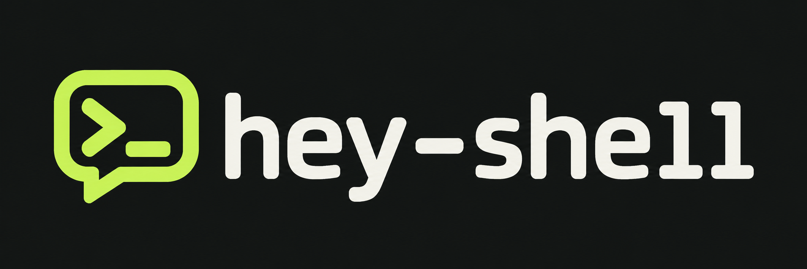
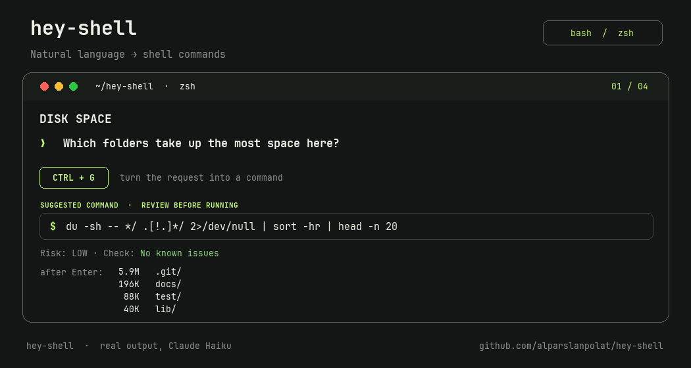

<h1 align="center"></h1>



Type what you want in plain language, press a key (**Ctrl+G** by default, configurable), and your prompt line is replaced with the shell command. It is **never executed for you**: you review, edit and press Enter.

```
$ grep the container ids of working docker   <Ctrl+G>
$ docker ps -q
SUGGESTED COMMAND · REVIEW BEFORE RUNNING
╭────────────────────────────────────────────────────────────────────────────╮
│ $ docker ps -q                                                             │
╰────────────────────────────────────────────────────────────────────────────╯
Risk: LOW · Check: No known issues
```

Works in bash and zsh on Linux, WSL2 and macOS. The commands come from the AI agent CLI you already use and are logged in to: [Claude Code](https://claude.com/claude-code) by default, or the [Codex CLI](https://github.com/openai/codex) or [Gemini CLI](https://github.com/google-gemini/gemini-cli) (see [Choose your agent](#choose-your-agent)).

## At a glance

The whole idea fits in one line: **type a request, press Ctrl+G, read the command, press Enter.**

| You type | What happens |
| --- | --- |
| a request, then **Ctrl+G** | the line becomes the command; read it, edit it, press Enter |
| `<command> # <change>`, then **Ctrl+G** | the command, changed as asked |
| `hse <request>` | the same command with a short explanation, left on your next prompt |

**When you need more**, these are there, and none of them is needed for the main flow:

| You type | What happens |
| --- | --- |
| `hsf` | right after a command fails: a corrected version, left on your next prompt |
| `hsw <command>` | explains a command you already have |
| `hsr <command>` | rates a command: low, medium or high |
| `hsc <command>` | looks for known reasons a command would fail, without running it |
| `hey-shell --history [text]` | your recent requests and the commands they produced |
| `hs` | the logo and the help |

`hs`, `hse`, `hsr`, `hsc`, `hsf` and `hsw` are the short aliases the installer offers for `hey-shell`, `hey-shell -e`, `hey-shell -r`, `hey-shell -c`, `hey-shell --fix` and `hey-shell -w`. The long forms always work.

## Install

```bash
curl -fsSL https://alparslanpolat.github.io/hey-shell/install | bash
```

Then open a new terminal. That is all: it downloads hey-shell into `~/hey-shell` (or updates it if it is already there) and runs the installer, which asks two questions. To answer them up front, add the installer's flags: `curl -fsSL https://alparslanpolat.github.io/hey-shell/install | bash -s -- --key alt+o --aliases --agent codex`.

`curl … | bash` runs a script from the internet, which is exactly what hey-shell's own risk check rates HIGH. If you would rather read it first, [the script](docs/install) is about 40 lines, or install by hand:

```bash
git clone https://github.com/alparslanpolat/hey-shell ~/hey-shell
~/hey-shell/install.sh
source ~/.bashrc        # or ~/.zshrc, or open a new terminal
```

The installer asks two things:

- **The key** that turns your request into a command (default `ctrl+g`). Keys are `ctrl+<letter|digit>` or `alt+<letter|digit>`; ones the terminal needs (`ctrl+c`, `ctrl+d`, `ctrl+z`, ...) are refused. On macOS, `alt+` keys need "Use Option as Meta key" enabled in your terminal.
- **Short aliases**: `hs`, `hse`, `hsr`, `hsc`, `hsf`, `hsw`. Press Enter for all of them, `n` for none, or `c` to pick each name. An alias you already defined yourself is left alone, and a name that would hide an existing command asks first.

It then adds one marked block to your rc file that sets the key, puts `hey-shell` on your `PATH`, adds the aliases and loads the key binding. To skip the questions, pass the answers: `~/hey-shell/install.sh --key alt+o --aliases` (or `--no-alias`; `--alias`, `--alias-explain`, `--alias-risk`, `--alias-check`, `--alias-fix` and `--alias-what` set single names; `--shell zsh` forces the shell).

### As a Claude Code plugin

```
/plugin marketplace add alparslanpolat/hey-shell
/plugin install hey-shell@hey-shell
/hey-shell:install
```

A plugin cannot bind keys in your shell by itself, so `/hey-shell:install` runs the installer above. The plugin also adds `/hey-shell:sh <request>` to get a command inside Claude Code.

## Choose your agent

hey-shell asks Claude Code by default. To use the Codex CLI or the Gemini CLI instead, install and log in to it, then re-run the installer with `--agent`:

```bash
~/hey-shell/install.sh --agent codex     # or gemini; --agent claude goes back to the default
```

This writes `export HEY_SHELL_AGENT=codex` into the hey-shell block of your rc file; you can also set it yourself. Everything else works the same with every agent: the key, `hse`, refine, `hsf`, the risk rating and the failure check. Only the text of the answer comes from the agent.

| Agent | Called as | Model |
| --- | --- | --- |
| `claude` (default) | `claude -p`, with no tools, no MCP servers and no saved session | `haiku`, or `HEY_SHELL_MODEL` |
| `codex` | `codex exec`, read-only sandbox, `--ephemeral` (no saved session) | the CLI's default, or `HEY_SHELL_MODEL` |
| `gemini` | `gemini -p … -o text` | the CLI's default, or `HEY_SHELL_MODEL` |

The test suite checks the exact command line each agent gets; the commands' quality has been measured with Claude Haiku (see CONTRIBUTING), not yet with the others.

## Update

```bash
hey-shell --update   # or -U; same as: git -C ~/hey-shell pull
```

Then open a new terminal (or `source` your rc file) so the shell picks up the new version. To change the key or aliases later, re-run the installer with the flags above.

hey-shell tells you when a new version is out with an `Update available: 0.3.0 → 0.4.0` line: under the command on the key binding, and after `hse`, plain `hey-shell`, `-r`, `-c`, `--help` and `--version`. It looks up the published version at most once a day, in the background, so it never slows a command down; set `HEY_SHELL_UPDATE_CHECK=0` to turn it off.

## Uninstall

```bash
~/hey-shell/install.sh --uninstall   # removes the block from your rc file
rm -rf ~/hey-shell
```

## Explain a command first

`hse "<request>"` (`hey-shell -e`) prints the command in a labeled box, a short explanation wrapped to 78 columns, an optional separate warning, and one status line with the risk and the failure check. The command is then left on your next prompt line, ready to edit and run with Enter (it is never run for you).

```
$ hse delete all stopped docker containers

SUGGESTED COMMAND · REVIEW BEFORE RUNNING
╭────────────────────────────────────────────────────────────────────────────╮
│ $ docker ps -aq -f status=exited | xargs -r docker rm                      │
╰────────────────────────────────────────────────────────────────────────────╯

Removes every container that has exited. Replace the filter to remove only some.
Warning: removal is permanent and also deletes the containers' writable data.

Risk: MEDIUM · Check: No known issues
  risk: stops or removes containers
```

Colors follow purpose: lime for the label and `$`, white for the command, amber for risk, red for danger, green only for a passed check, gray for labels and hints. They appear on a terminal only; `NO_COLOR=1` turns them off.

Placeholders such as `<branch-name>` are left in the prefilled line for you to replace. In zsh the prefill uses `print -z`. In bash it relies on the terminal answering a status query (`ESC[5n`), which most terminals do; if yours doesn't, you just get the printed output without the prefill.

Generated commands favor portable, read-only forms and avoid `sudo` and destructive flags unless you ask for them in the request.

If something goes wrong you get one actionable line instead of a stack trace: the agent's CLI missing (with the install link), not logged in, rate limited, unreachable, or too slow to answer.

## Refine, fix and explain

**Refine.** Not quite right? Add `# ` and what to change after the command, then press your key again:

```
$ grep -rn TODO . # only shell files, skip tests     <Ctrl+G>
$ rg -n --glob '*.sh' --glob '!*test*' TODO .
```

**Fix the last command.** Run `hsf` (`hey-shell --fix`) right after a command fails. It takes the command and its exit status from your shell history, asks for a corrected version, explains what was wrong, and leaves the fix on your next prompt like `hse` does. Nothing is re-run. You can also pass a command: `hey-shell --fix "gti status"`.

**Explain a command.** `hsw "<command>"` (`hey-shell -w`, `--what`) explains a command you found or were given, with its risk and failure check, before you decide to run it.

Explanations come in the language of your request; `--what` and `--fix` use your locale (`LANG`), so a `tr_TR` system gets Turkish.

**History.** Every request and the command it produced is logged on your machine in `~/.local/state/hey-shell/history.tsv`. `hey-shell --history` shows the last 20, and `hey-shell --history docker` filters them. Set `HEY_SHELL_HISTORY=0` to turn it off.

## Fits your setup

Each request also tells the agent which modern tools you have installed (such as `rg`, `fd`, `jq`, `gh`) and what the current folder is: the package manager from its lockfile (npm, pnpm, yarn, bun, cargo, uv, poetry and others), a Makefile and its targets, `package.json` script names, docker compose, and the git branch. So you get `rg` instead of `grep -r` when you have it, and `pnpm run test` in a pnpm project. Only names are sent, never file contents. Set `HEY_SHELL_CONTEXT=0` to turn it off.

## Predict failures (on by default)

`hsc "<command>"` (`hey-shell -c`) predicts whether a command would fail, without running it. The same prediction runs automatically after `hse` and on the key binding; set `HEY_SHELL_CHECK=0` in your rc file to turn that off. Example, from a shell that is not in a tmux session:

```
$ hse how to split terminal into 4

SUGGESTED COMMAND · REVIEW BEFORE RUNNING
╭────────────────────────────────────────────────────────────────────────────╮
│ $ tmux split-window -h \; split-window -v \; select-pane -t 0 \;           │
│   split-window -v                                                          │
╰────────────────────────────────────────────────────────────────────────────╯

Splits the current tmux window into a 2x2 grid of four panes.

Risk: LOW · Check: LIKELY FAIL
  check: no tmux server is running; start tmux first
```

What it looks at:

- **Syntax:** the command is parsed with `bash -n` or `zsh -n`, which never executes it.
- **Programs:** every program in a pipeline or `&&` chain must exist as an executable, builtin, keyword, or one of your own aliases and functions.
- **Environment:** `git` needs a repository, `tmux` needs a running server, `docker` needs its socket. These use read-only probes (`git rev-parse`, `tmux list-sessions`, a socket test).

It is a prediction, not a guarantee. It cannot know whether a file exists, whether you have permission, or what a program does with its arguments. It skips commands behind `sudo -u ...` or other wrapper options, does not look inside `$((...))`, array literals or `case` patterns, and leaves out anything it cannot tell for sure: a wrong "likely fail" on a working command is worse than a missed one. The only way to be sure a command works is to run it, which hey-shell will never do for you.

## Configuration

| Variable | Default | Meaning |
| --- | --- | --- |
| `HEY_SHELL_AGENT` | `claude` | the agent CLI that answers: `claude`, `codex` or `gemini` (see [Choose your agent](#choose-your-agent)) |
| `HEY_SHELL_MODEL` | `haiku` for claude, the CLI's default for codex and gemini | model passed to the agent CLI |
| `HEY_SHELL_TIMEOUT` | `30` | seconds to wait for the agent before giving up |
| `HEY_SHELL_UPDATE_CHECK` | on | `0` = no "Update available" line |
| `HEY_SHELL_CONTEXT` | on | `0` = do not tell the agent about installed tools and the project |
| `HEY_SHELL_HISTORY` | on | `0` = do not log requests to `~/.local/state/hey-shell/history.tsv` |
| `HEY_SHELL_CHECK` | on | `0` turns off the failure prediction after `hse` and on the key binding |
| `HEY_SHELL_COLOR` | `auto` | `always` or `never` overrides the terminal detection; `NO_COLOR` always wins |
| `HEY_SHELL_KEY` | `ctrl+g` | trigger key: `ctrl+x`, `alt+x`, or a raw `bindkey` / `bind` sequence. The installer sets this for you |
| `HEY_SHELL_CLI` | `claude`, `codex` or `gemini` | the agent's executable, for a custom path (the tests use it to inject a fake; `HEY_SHELL_CLAUDE` still works) |

Set them with `export` before the hey-shell block in your rc file.

## Safety

Commands are only placed on the prompt, never executed. Each generated command is also rated, and the rating is shown on the status line under it:

| Level | Shown as | Examples |
| --- | --- | --- |
| high | `Risk: HIGH` in red, with the reason | `curl … \| bash`, `eval "$(curl …)"`, `base64 -d \| sh`, `rm -rf`, `find … -delete`, `rsync --delete`, `git push --force`, `git reset --hard`, `docker volume rm`, `kubectl delete`, `terraform destroy`, `aws s3 rm --recursive`, SQL `DELETE`/`UPDATE` without `WHERE`, `dd`, `mkfs` |
| medium | `Risk: MEDIUM` in amber, with the reason | `sudo`, `rm`, `mv`, `kill`, `sed -i`, `> file`, `git push`, `npm publish`, `brew install`, `pip install`, `docker compose down`, `kubectl apply`, `systemctl restart`, `chown -R`, writes to `/etc` |
| low | `Risk: LOW` | everything else |

The failure check works the same way: `Check: No known issues` means none of its checks found a problem (syntax, missing programs, no git repository, no tmux server, no docker daemon). It does not mean the command was tested or will succeed.

**What the checks cannot detect.** Both are pattern matching on the command's text, not a guarantee:

- Commands built at run time: `$(echo rm) -rf build`, `x=rm; $x -rf build`, `eval "$cmd"`.
- What a script or program does once it runs: `./deploy.sh`, `make clean`, `npm run reset`.
- Your aliases and functions, unless they are defined in the shell you pressed the key in.
- Whether files, hosts, permissions, credentials or databases are what the command expects.
- Data loss through a program's own options they do not know about.

So always read the command before pressing Enter. `hsr "<command>"` rates one by hand.

Every reply is also validated before it reaches your prompt: terminal control characters are removed, a leading `$ ` or wrapping backticks are stripped, and prose, several separate commands or an unusually long reply are refused with a message instead of being placed on your prompt.

## Privacy

Each request goes to your chosen agent through its own CLI, under your account with that provider: Anthropic for Claude Code, OpenAI for Codex, Google for Gemini. hey-shell sends the text of your request, your OS, your shell name and the path of your current directory, plus the names described in [Fits your setup](#fits-your-setup) (installed tools, project type, script and target names, git branch; turn off with `HEY_SHELL_CONTEXT=0`). `hey-shell --fix` also sends the command being fixed and its exit status. It does not send file contents, environment variables or the rest of your shell history. The agent CLI may add context of its own, such as its settings or memory files, which is why answers sometimes mention tools you use.

The risk rating and the failure check run locally and send nothing. Your request history stays in `~/.local/state/hey-shell/history.tsv` on your machine.

## Troubleshooting

**`hey-shell: command not found` or `hs: command not found` right after installing.** The installer edits your rc file, and only new shells read it. Open a new terminal or run `source ~/.bashrc` (`~/.zshrc` in zsh). The file name is `.bashrc`, with no dot in the middle.

**Ctrl+G in macOS's built-in bash (3.2).** That bash cannot read or replace the line from a key binding, so there the key turns your request into a comment and accepts it (nothing runs), reads it back from history, removes it again, and puts the command on the next prompt. It works the same; you just see your request on its own line first. Homebrew's bash 5 (`brew install bash`) or zsh replace the line directly.

**Ctrl+G does nothing.** Check the key is bound: `bind -X | grep hey_shell` in bash, `bindkey | grep hey_shell` in zsh. If nothing is listed, open a new terminal. If another tool uses the key, pick a different one with `~/hey-shell/install.sh --key ctrl+o`.

**"thinking..." and then an error.** The agent's CLI must be installed and logged in: run `claude` once and complete `/login` (Codex: `codex login`; Gemini: run `gemini` once and sign in). A slow network can hit the timeout; raise `HEY_SHELL_TIMEOUT`.

**`hse` prints the command but does not leave it on the next prompt (bash).** Your terminal does not answer the status query the prefill uses. Copy the command from the output; in zsh this always works.

**`alt+` keys type symbols on macOS.** Enable "Use Option as Meta key" in your terminal's settings, or use a `ctrl+` key.

**The check says LIKELY FAIL but the command works.** The check is a prediction. Please open an issue with the command; contributors add such commands to `test/valid-commands.txt` so they are never flagged again. `HEY_SHELL_CHECK=0` turns the check off.

**The command is wrong or not what you meant.** Name the tool you use ("in tmux", "with herdr"), use `hse` to read what the command does, or try a larger model with `HEY_SHELL_MODEL=sonnet`.

## Contributing

See [CONTRIBUTING.md](CONTRIBUTING.md) for how the code fits together and how to run the tests.

## License

MIT
