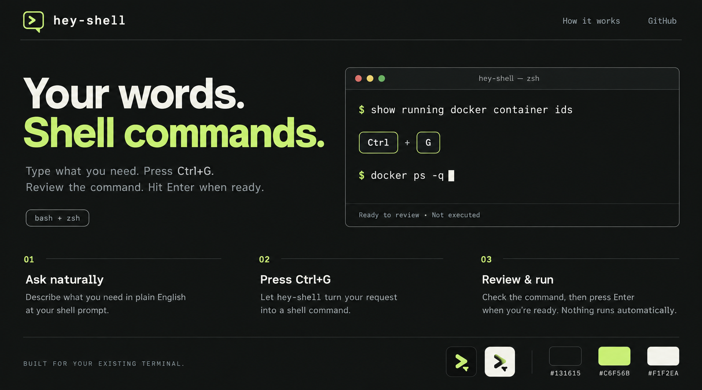

<h1 align="center"></h1>



Type what you want in plain language, press a key (**Ctrl+G** by default, configurable), and your prompt line is replaced with the shell command. It is **never executed for you**: you review, edit and press Enter.

```
$ grep the container ids of working docker   <Ctrl+G>
$ docker ps -q
```

Works in bash and zsh on Linux, WSL2 and macOS. Uses the [Claude Code](https://claude.com/claude-code) CLI (`claude -p`), so it must be installed and logged in.

## Install

```bash
git clone https://github.com/alparslanpolat/hey-shell ~/hey-shell
~/hey-shell/install.sh          # asks which key to use (default ctrl+g); detects bash/zsh, add --shell zsh to force
~/hey-shell/install.sh --key alt+o # or pass the key directly; re-run with a new --key to change it
source ~/.zshrc                    # or ~/.bashrc, or open a new terminal
```

The installer appends one marked block to your rc file. Keys are `ctrl+<letter|digit>` or `alt+<letter|digit>`; terminal-reserved ones (`ctrl+c`, `ctrl+d`, `ctrl+z`, ...) are refused. On macOS, `alt+` keys need "Use Option as Meta key" enabled in your terminal. Remove everything with `./install.sh --uninstall`.

### As a Claude Code plugin

```
/plugin marketplace add alparslanpolat/hey-shell
/plugin install hey-shell@hey-shell
/hey-shell:install
```

A plugin cannot bind keys in your shell by itself, so `/hey-shell:install` runs the installer above. The plugin also adds `/hey-shell:sh <request>` to get a command inside Claude Code.

## Configuration

| Variable | Default | Meaning |
| --- | --- | --- |
| `HEY_SHELL_MODEL` | `haiku` | model passed to `claude --model` |
| `HEY_SHELL_KEY` | `ctrl+g` | trigger key: `ctrl+x`, `alt+x`, or a raw `bindkey` / `bind` sequence. The installer sets this for you |

Set `HEY_SHELL_MODEL` before the `source` line in your rc file; `HEY_SHELL_KEY` is written there by the installer.

## Safety

Commands are only placed on the prompt. If one matches a destructive pattern (`sudo`, `rm -rf`, `dd`, `mkfs`, `docker system prune`, writes to block devices, ...) you get a warning. This is a heuristic, not a guarantee: always read the command before pressing Enter. Your request and current directory path are sent to the model.

## License

MIT
